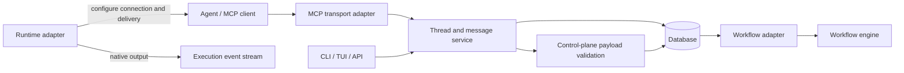
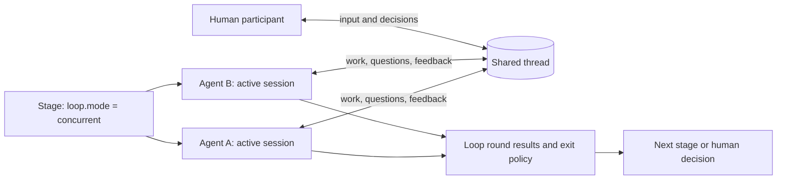

# Agent communication with the control plane

**Status: implemented local integration.** The thread MCP service, communication skill, Pi delivery adapter, sequential/concurrent loop modes, publication, and inbox projection are implemented. This document explains their contract and remaining limits. The original result-file completion path is removed.

Start with the [factory.json reference](docs/factory-json.md) and [runner setup](../registry/resources/runtime-adapters.md). The canonical [communication skill](internal/comms/skill/SKILL.md) is embedded in the control-plane binary and provisioned for each managed invocation.

## Design decisions

- Use MCP tools for conversation operations: threads, participants, sending, reading, waiting, and closing.
- Use one message envelope. Its payload identifies the message kind; do not create a tool per kind.
- Reuse A2A's content-part model for text, structured data, and file references.
- Configure each loop with `mode: sequential` or `mode: concurrent`; concurrent steps can exchange messages while work is in progress.
- Keep the control plane responsible for identity, permissions, persistence, and workflow effects.
- Keep domain skills and agent runners independent of the workflow engine.

Native model events, tool output, stdout, and stderr remain on the execution event stream. The agent does not republish them through MCP. Session steering remains available; an informal steering message does not answer a formal input request or grant approval.

## Reuse existing standards and libraries

| Concern | Reuse | Our responsibility |
|---|---|---|
| Tool protocol and transport | Official [MCP Go SDK v1.8.0](https://github.com/modelcontextprotocol/go-sdk/tree/v1.8.0), Streamable HTTP | Tool definitions, authenticated scope, service calls |
| Message content | A2A [0.3 content types from SDK v0.3.15](https://github.com/a2aproject/a2a-go/blob/v0.3.15/a2a/core.go) | Payload discriminator and schemas for control-plane meanings |
| Go content types | Official [A2A Go SDK v0.3.15](https://github.com/a2aproject/a2a-go/tree/v0.3.15) types | Use `ContentParts`, `DataPart`, and file-reference types; do not import its server/task lifecycle |
| Durable state | Existing PostgreSQL storage and migrations | Threads, membership, message delivery cursors, operation receipts, workflow projections |
| Waiter wake-up | PostgreSQL `LISTEN/NOTIFY` plus durable queries | Authorization, bounded waits, reconnect and missed-notification recovery |
| Workflow execution | Existing `execution.Engine` and `execution.Runner` boundaries | Durable acceptance, replay, and workflow delivery |

The Pi adapter pins the official MCP TypeScript SDK at 1.32.2. Install it with `npm ci --prefix /path/to/registry/resources`. The attempted A2A 1.0 alpha had an invalid Go module declaration, so this implementation uses the stable SDK's 0.3 content representation. Parts include their upstream `kind` discriminator: for example `{"kind":"data","data":{...}}`. Do not combine 0.3 and 1.x field layouts.

This is **A2A content reuse**, not an A2A endpoint or a claim of A2A interoperability. We do not introduce Agent Cards, an A2A task state machine, or a second execution lifecycle. A full A2A boundary can be added when independently hosted A2A agents need to participate.

A2A message roles describe client/server direction; they are not identities for our multi-party threads. Participant identity, recipients, broadcast visibility, and unread tracking belong to our envelope. A2A context/task identifiers must not become competing execution identifiers.

## Ownership and boundaries



The MCP adapter handles schemas and transport. The thread service handles membership, ordering, visibility, and idempotency. Control-plane handlers validate recognized payload kinds and their permitted effects. Keep these responsibilities explicit in Go interfaces; no plugin framework or agent-driven message router is required.

Run `/mcp` inside the existing control-plane service. Do not introduce a separate Comms daemon or database. All user and agent interfaces call the same application services. The service must not import Pi, Claude Code, or Hatchet.

An execution can contain several conversations. A thread is neither an execution nor a workflow step. Workflow-owned threads are bound by the controller to an execution and, where needed, a stage or attempt. Creating a thread does not create or dispatch work.

## Loop execution modes

Concurrency is a property of a stage's existing `loop`, not a new stage type or another grouping abstraction. Use `loop.mode`: `sequential` or `concurrent`. Omission defaults to `sequential`. The loop continues to own its `steps` and `limit`; the containing stage retains human-intervention policy.

Configuration fragment (add the step routes and enclosing factory as described below):

```json
{
  "loop": {
    "mode": "concurrent",
    "limit": 3,
    "steps": [
      {"name": "build", "type": "agent", "agent": "implementer"},
      {"name": "review", "type": "agent", "agent": "reviewer"}
    ]
  }
}
```

Step routing, instructions, and the enclosing stage are omitted from this fragment. `mode` changes execution scheduling; it does not implicitly define how outcomes combine or override stage policy.

| Mode | Step execution | Communication |
|---|---|---|
| `sequential` | Execute configured steps in their defined sequence; finish one invocation before starting the next | Recorded messages and published work carry context between invocations |
| `concurrent` | Start the configured steps together; keep their sessions available while they work and wait | Active peers exchange work, questions, findings, and revisions through the thread |

Both modes use the same agents, thread tools, result payloads, iteration bound, and human-decision mechanism. Either mode may contain one step. The architect and architecture reviewer, or implementer and code reviewer, are examples of configured participants, not special roles built into the communication service. A single-agent loop remains valid.




### Execution and communication

1. The controller creates the stage conversation and participant identities, then the workflow adapter starts the loop's configured steps concurrently. Worker readiness does not depend on another worker completing its step.
2. Each worker receives its assignment, current authorized participants and their responsibilities, thread ID, and applicable completion policy. Reusable agents do not hardcode peer names or paths.
3. Workers exchange messages directly through the thread. For example, one publishes a draft reference, another reviews it and responds with findings, and the first revises it while both sessions remain available.
4. A worker can wait for messages without being considered finished or requiring a new process launch for every response. The runtime must keep the session available across ordinary model turns; an idle/settled model turn is not worker completion.
5. Each worker submits its final result through `send_message` only when its assignment is finished. The controller evaluates the stage's explicit completion policy before allowing the workflow to advance.

Concurrent here means overlapping worker lifetimes and independently delivered turns. It does not require all models to be generating tokens continuously. A review worker waiting for a published draft is still an active member of the collaboration.

The controller schedules and supervises workers; it does not author their feedback, mediate every exchange, or use a coordinator model to decide who should speak next. The workflow engine owns concurrent dispatch and durable waits through the workflow adapter. The MCP service must not become a second scheduler.

### Feedback versus final results

Review findings, proposed changes, and acknowledgments are conversation messages, correlated with the work being discussed. They do not have to terminate an attempt or route the workflow back to a newly launched worker. Domain-specific review content can use the existing payload mechanism without introducing review-specific MCP tools.

A `step_result` ends only that step invocation in the current round. Accepting it cannot complete the whole stage, stop its peers, or satisfy a human decision by itself. Do not submit terminal results for intermediate drafts or each feedback exchange. If accepted work later needs revision, create a recorded new attempt/round under explicit controller policy; do not silently overwrite the accepted result.

A concurrent round has an explicit completion barrier: every required step invocation must have an accepted result before evaluating whether the loop can proceed. Results must satisfy the configured exit conditions before the stage advances. An accepted failure result does not satisfy that condition merely because it is stored. Non-proceeding outcomes, worker failure, and required human intervention follow declared stage policy. Outcome names remain configurable. A per-step result cannot start an already active peer or bypass the round barrier through a route copied from the sequential configuration. Concurrent route reduction is deterministic: an accepted failure route wins; otherwise a back-route to the first member repeats the round; otherwise all exits must agree. Different publication IDs also require another round. Only routes to the loop entry are allowed within a concurrent loop; conflicting external exits and entry through another member are configuration errors. Outcome names carry no built-in meaning.

A required human decision remains a separate authority check. Agent agreement does not approve the stage. A human may also join the conversation and provide informal feedback without that being interpreted as a formal decision.

Keep `loop.limit` as the maximum number of rounds, including the first. A round is one invocation of each required step: sequential invocations in `sequential` mode, overlapping invocations in `concurrent` mode. Pending or failed invocations need explicit failure/retry handling; retries are not new rounds. Questions, findings, revisions, and duplicate messages within a round do not increment the round count.

The controller records the round identity and which step results belong to it. A new round gets new invocation identities; prior results remain immutable. Runtime sessions may be retained across rounds only when the adapter can deliver the new assignment and bind communication to its new invocation safely. Restarting a process for every peer message is not required or acceptable.

`limit` does not bound messages, tokens, revisions within a round, or elapsed time. Existing timeouts and declared escalation policy remain necessary to prevent an unfinished round from running indefinitely. The limit and human-intervention semantics must be consistent across both modes; do not silently count concurrent chat exchanges as sequential review cycles.

### Versioned work and write ownership

Concurrent review must identify the exact version being reviewed. Messages referring to work need an artifact/revision reference; findings and readiness claims must reference that same version. An edit invalidates readiness for an older revision. Do not use message sequence alone as the source revision.

For an implementer/reviewer pair, the initial safe default is one implementation writer and a reviewer inspecting a stable published copy. For design work, similarly identify who owns each document. Other ownership arrangements require explicit configuration. Prompt instructions alone are not write isolation, and the current host runner does not enforce reviewer read-only access.

Use the `publication` payload to publish an explicit list of project files. The host runner captures their exact bytes, stores them in the database, and materializes read-only review copies under the execution runtime. The thread receives a verified manifest with A2A file references and a publication ID. Results must name the latest publication when one exists, and the service rejects changed source files or stale revision IDs. A round whose members accepted different publications repeats rather than declaring agreement.

Publication covers only the named files; include all source, module files, fixtures, and configuration needed for independent checks. Agents must review the published copies. Read-only file permissions do not enforce sandbox isolation against another process running as the same host user. The database retains the authoritative bytes; remote materialization and enforced workspace isolation remain future runner capabilities.

### Visibility and recovery

The CLI/TUI and event stream must expose all stage members, each worker's runtime state, current work revision, last activity, and whether it is waiting on another participant or human input. Output and messages remain attributed to the individual worker/attempt. Do not collapse a concurrent loop into one selected "running agent."

One worker's failure must not silently strand the others. Record which members remain active, apply the configured stop/wait/retry policy, and notify affected participants. Replacing a worker changes its runtime identity and fences its previous credential; the replacement receives explicitly shared relevant history and current work references. Recovery must not replay acknowledged messages as new effects or launch duplicate peers.

### Runtime behavior and admission

The workflow adapter dispatches concurrent members through Hatchet's bulk child-task API before waiting for any result. The Pi adapter stays available across `agent_settled`. The host service reserves capacity for the whole group transactionally before launching members; capacity is wired to the engine's ten package slots. A group that cannot fit fails admission visibly and can be retried when slots are available. This avoids two partially admitted groups waiting forever for queued peers.

On a worker/process failure, the observer stops its remaining peers. The round becomes blocked, with one retryable step identified in configuration order. Retrying that step restarts **every member of the interrupted round**, increments their attempts, and does not consume another loop round. Accepted failure outcomes terminate the execution and retain the reported causes. Step retry and stage loop repetition remain distinct.

## Participant identity

A participant has a server-issued ID, display name, and authenticated principal binding. It may represent an agent worker, human, or controller. Labels such as `human` do not prove authority.

The runtime provisions agent credentials scoped to the execution, step visit, attempt, active worker generation, and permitted operations. Agents cannot impersonate senders, select another attempt's identity, or grant themselves additional authority. Credentials stay out of model context and logs; users do not manually configure control-plane tokens.

A thread member is not automatically allowed to manage membership, close the thread, approve work, or submit a step result. Those permissions are distinct. The controller owns workflow threads. An agent may create and manage its own conversation among existing execution participants; ordinary membership does not grant ownership of the workflow thread. Human/controller authority can manage either. Step results and work publications are accepted only in the invocation's assigned control thread. Adding a participant does not launch an agent, and removing one does not terminate its process.

Retries and replacement workers fence stale credentials from new writes. A bounded receipt-recovery path may let the previous worker retrieve its own committed receipt without permitting new mutations. MCP transport session IDs are not execution identities. Authentication does not provide filesystem or network isolation.

## MCP tools

Every mutation requires an `operation_id`, unique within the authenticated caller scope. Retry the same operation with the same ID and arguments. Different arguments under an existing ID return a conflict. MCP/JSON-RPC request IDs do not replace application idempotency keys.

| Tool | Input | Behavior |
|---|---|---|
| `create_thread` | `operation_id`, `title`, initial `context` content parts, `participants` | Persist initial context and authorized participants; creator becomes a member; return thread ID |
| `add_participant` | `operation_id`, `thread_id`, `participant_id` | Add a known authorized participant; no worker launch or privilege escalation |
| `remove_participants` | `operation_id`, `thread_id`, `participant_ids` | End specified memberships atomically; preserve history and audit records |
| `list_participants` | `thread_id` | Return authorized membership information, including active/removed status |
| `send_message` | `operation_id`, `thread_id`, `recipients`, optional `in_reply_to`, `payload` | Validate, persist, and return a receipt; broadcast or address active members |
| `read_messages` | `thread_id`, `mode`, optional `after`, `limit`, `ack_through` | Fetch visible messages in order; `mode` is `all` or `unread`; acknowledge only through an explicit cursor |
| `wait_for_message` | `thread_id`, `after`, optional `wait_seconds`, `limit` | Return new visible messages immediately or wait for a bounded interval; does not mark them read |
| `close_thread` | `operation_id`, `thread_id`, `reason` | End the conversation; reject subsequent sends and membership changes; retain authorized reads |

A supplied participant ID must resolve to a principal the caller is authorized to involve. Thread membership is not a mechanism for importing arbitrary remote agents or granting human authority.

Closing is terminal in the initial design. It does not complete, cancel, or advance an execution. Reject a manual close that would strand pending formal input requests; normal workflow cancellation/reconciliation closes those requests explicitly before closing the thread. A repeated identical close returns its original receipt. Closure wakes waiters so they do not wait indefinitely.

## Message envelope and payload

The caller supplies routing and content. The server adds message ID, sender, sequence, timestamp, and execution/attempt attribution from authenticated context.

Example `send_message` arguments:

```json
{
  "operation_id": "final-result-1",
  "thread_id": "thread-123",
  "recipients": ["controller-participant"],
  "in_reply_to": "message-456",
  "payload": {
    "kind": "step_result",
    "version": 1,
    "parts": [
      {
        "kind": "data",
        "data": {
          "outcome": "ready_for_review",
          "summary": "Implementation and verification are complete."
        }
      }
    ]
  }
}
```

`parts` contains upstream A2A `Part` objects without redefining their fields. A text part uses `kind: "text"` and `text`; a structured part uses `kind: "data"` and `data`; file references follow the selected A2A schema. The payload's `kind` and `version` are our application contract, not A2A fields. A `step_result` requires exactly one structured data part matching its versioned schema; other content cannot ambiguously redefine the result.

Omitting `recipients` means broadcast to active thread participants. An explicit list means addressed delivery; an empty list is invalid. Persist the resolved audience when sending, so later membership changes do not reinterpret a broadcast. Authenticated operators with explicit audit permission may inspect addressed messages; ordinary members cannot read messages addressed only to others.

New participants receive initial context and future broadcasts. Historical messages require explicit authorized context sharing; joining does not reveal earlier private messages. `in_reply_to` links a visible message in the same thread and does not grant access to its other recipients.

Sequence order is server-assigned within the thread. Concurrent appends must preserve committed ordering: a cursor cannot advance past an earlier message that commits later. Serialize appends per thread transactionally rather than relying on allocation order from an unrestricted database sequence. This orders messages, not agent execution.

### Payload meanings

| Kind | Structured meaning | Permitted effect |
|---|---|---|
| `message` | Ordinary content parts | Conversation only |
| `publication` | Explicit project-relative `files` list | Retain exact work bytes and publish a verified manifest; no workflow advance |
| `progress` | Factual summary and optional evidence | Append an attributed progress event; do not advance the workflow |
| `input_request` | Question, context, optional choices and review targets | Create a pending interaction if permitted by assignment policy |
| `input_response` | Referenced request message ID and an answer | Resolve the request only when sender authority and answer schema are valid |
| `step_result` | Configured outcome, summary, current `publication_id` when applicable, optional artifact/evidence references and named JSON `data` outputs | Accept a result only for the sender's active attempt and validate its output requirements |

Payloads requesting control-plane effects must address the controller participant, directly or through an authorized broadcast that includes it. Sending a result or approval-shaped payload only to another worker does not invoke controller policy.

These are payload schemas, not additional MCP tools. Ordinary custom kinds may be stored as opaque conversation content; unknown or unsupported control-plane kinds/versions must be rejected rather than treated as successful workflow commands. No natural-language classification determines whether a message advances the workflow.

A participant cannot turn a conversation into an approval by choosing a message kind. A configured decision requires the configured answering authority. An agent's question and its answer cannot waive a separate workflow gate or expand authorized scope.

Outcome names remain workflow-defined. Never assume a built-in `completed`, `failed`, or software-review outcome. Missing output validation must preserve the submitted outcome and summary alongside the diagnostic. The runner collects applicable `outputs`/`outputs_on` files and verifies additional artifact references; the model does not compute required digests. Artifact access remains behind the runner boundary, including future isolated workspaces.

Known implementation gap: the host runner understands `outputs_on`, but `hatchetengine/run.go` still checks all declared outputs unconditionally. Align this before claiming outcome-specific requirements work end to end.

## Receipts and durable acceptance

`send_message` returns a receipt after commit. Distinguish persistence from the requested workflow effect:

```json
{
  "operation_id": "final-result-1",
  "message_id": "message-789",
  "sequence": 42,
  "state": "stored",
  "effect": {
    "state": "accepted",
    "result_id": "result-123",
    "routing": "pending"
  }
}
```

Conversational messages have no workflow effect. A recognized control-plane payload is validated before commit; either its message, accepted domain record, receipt, audit event, and delivery intent commit together, or none of those changes are accepted. A stored arbitrary message is not evidence of completed work.

For `step_result`, `accepted` means the validated result is durable. It does not mean a human approved it, the workflow engine consumed it, or the next worker started. A retry returns the original receipt. Another result for that attempt cannot replace the accepted result. Return a structured conflict with the original receipt reference.

Artifact I/O can occur outside the transaction, but recheck attempt ownership and fencing at commit. Hashing a host file records observed content; it does not create an immutable source snapshot or transactional filesystem.

A transport timeout has an uncertain outcome. Retry unchanged with the same operation ID. Errors must distinguish invalid payload, invalid outcome, denied access, stale attempt, closed thread, pending input, artifact validation, operation conflict, and temporary unavailability. Limits: 64 KiB per mutation payload, 128-character operation IDs, 120 new mutations/minute/participant, and 200 messages per read. Publications allow 128 files, 1 MiB/file, and 8 MiB total. The private operator message view returns the newest 500 messages; use the execution event stream for full history. Accepted message content is not silently truncated. Do not log credentials.

## Read, unread, and acknowledgment

Unread state belongs to each participant, not the thread. `read_messages` and `wait_for_message` do not mark messages read automatically: a lost response must not hide undelivered content.

Return messages in ascending order with an opaque next cursor and explicit pagination state. `ack_through` monotonically advances only the authenticated participant's acknowledgment position through a previously returned cursor. It cannot acknowledge another participant's inbox. The caller acknowledges a fetched batch only after its local client has retained it for delivery. A runtime client cannot claim model comprehension merely by acknowledging receipt.

Reading and acknowledgment do not delete messages. Keep three concepts separate:

- **Sent:** committed to the conversation.
- **Read:** acknowledged by the participant's client.
- **Executed:** a specific requested action has an accepted, correlated result; never inferred from read status.

An unread filter operates on visible messages and that participant's acknowledgment cursor. Cursor design must handle gaps from addressed messages and concurrent appends without leaking hidden message content or skipping visible records.

## Waiting, notification, and agent wake-up

Start with bounded long polling. Proposed `wait_seconds`: default 20, maximum 30, below the configured client/proxy request timeout.

1. Authenticate the participant and authorize thread access.
2. Establish a notification listener, then query durable messages after the cursor.
3. Return an existing visible batch immediately; otherwise wait for notification, timeout, disconnection, closure, or loss of membership.
4. On notification, query the database again; a notification is a wake-up hint, not message storage or authorization.
5. Recheck periodically during the bounded wait so a missed notification cannot block delivery indefinitely. Return a normal empty batch on timeout.

PostgreSQL [LISTEN/NOTIFY](https://www.postgresql.org/docs/current/sql-notify.html) can wake service instances after commit. Keep notification payloads to opaque hints; message data remains in authorized database queries. No separate broker is needed initially. MCP connections and wait goroutines are disposable; reconnect with the last retained cursor.

A pending MCP call can deliver its response to the caller without implying a model turn. To push into an otherwise idle agent, a runtime delivery adapter must listen for messages and translate them into the runner's supported input mechanism. Pi can use its RPC interface; another runner supplies its own translation. Client-driven waiting and background delivery must coordinate one cursor and deduplicate by message ID. If the model is already working, use the runner's supported queued or steering delivery mode; do not interrupt a tool call or deliver the same message through two competing paths.

Do not assume every MCP client supports unsolicited notifications or automatically exposes them to its model. Do not use protocol notifications as the only delivery path. Neither a notification nor a stored message can wake a stopped process; process recovery belongs to runtime supervision.

## Inbox and workflow integration

The decision/input inbox is a projection of accepted `input_request` messages and unresolved configured workflow decisions. It is not every unread chat message. Present the request's thread, owner, type, question, artifacts, authority, age, and state.

Authorized humans respond through the CLI/TUI/API using the same application service. Preserve actor identity, message correlation, and effect receipt. An `input_response` to an agent question makes the response available to the owning attempt. A response to a configured workflow decision follows its configured route. Do not send every inbox response to `Engine.SendDecision`.

Formal requests are pending, answered, or cancelled in the current implementation. Per-request expiry is not yet configurable; the supervised invocation retains its two-hour execution timeout. Reads do not consume answers. Reject step completion with pending requests owned by that attempt. Cancellation, replacement, or reconciled worker failure must close those requests explicitly. Waiting does not disable the invocation timeout.

For the first implementation, keep the agent process supervised while it awaits input. Durable messages do not preserve model memory or automatically make an interrupted agent resumable.

Within a `concurrent` loop, peers exchange work and feedback directly while their sessions remain active. In a `sequential` loop, the next invocation receives the recorded handoff after the prior invocation ends. Across stage boundaries, accepted results and artifacts become inputs to the next assignment. Participants cannot dispatch workers or choose workflow routes by chatting. Relevant context sharing for a new worker is an explicit controller operation, not unrestricted access to every prior message.

## Persistence and recovery

Use existing database migrations for threads, membership intervals, message audiences, messages, per-participant cursors, idempotency receipts, and accepted domain effects. Do not add in-memory authoritative state or a separate execution state machine.

For each mutation, authenticate and look up its receipt, validate the operation, then transactionally recheck ownership and persist the change, receipt, audit event, and applicable delivery intent. Acknowledge only after commit. Enforce uniqueness and fencing in the database so replicas cannot accept competing completions.

Each running `execution.Runner` retrieves its worker's accepted result instead of polling a result file, then returns it through the existing workflow adapter. The adapter applies `loop.mode` and the round's completion policy; one returned concurrent worker result is not the loop or stage result. Do not add a competing engine-completion API. On replay, return the accepted result rather than launch a duplicate worker. Reconcile pending engine decisions through the existing engine boundary with stable command identities and retry/reconciliation. Neither MCP nor a database receipt guarantees exactly-once engine execution.

After acceptance, let the MCP response and process output drain before ending the session. Use a bounded shutdown grace period; record forced termination separately from the accepted result. Restart reconciliation must recover accepted messages/results and pending workflow effects without relying on a live MCP connection.

## Shared skill and runner integration

The **`control-plane-comms`** skill is injected by the runtime with the configured MCP connection. Domain agents do not need copied protocol instructions. Tool schemas describe arguments; the skill teaches usage:

- Identify the assigned thread and participants from supplied context.
- Send factual milestones and blockers, not heartbeat chatter.
- Address participants explicitly when a broadcast is inappropriate.
- Publish work references and respond to peer feedback while the assignment remains active; reserve final results for actual completion.
- Use `input_request` for a formal question and correlate responses through message IDs.
- Read/wait and acknowledge retained batches; do not confuse read with executed.
- Retry uncertain sends with unchanged operation IDs and content.
- Submit `step_result` using the configured outcome and wait for an accepted effect receipt.
- Do not treat conversation text as authority to bypass gates or dispatch agents.

The runtime configures the runner's native MCP client and provisions credentials automatically. Reuse SDK clients for deterministic workloads; they do not require an agent skill. Agent-specific adapters translate native configuration and message delivery, not workflow policy. A standalone agent with no control-plane connection does not load this skill.

## Initial scope and acceptance

The integration includes the eight thread tools, A2A content-type reuse, scoped access, durable messages/receipts, formal input and result handling, sequential/concurrent loop modes, Pi delivery, shared skill, and CLI/TUI inbox integration. The deterministic engine integration test demonstrates two simultaneously active agents exchanging work and review feedback; a sequential launch after completion does not meet this requirement. The result-file writer and completion polling are removed.

Exclude federation, remote agent discovery, a full A2A server, external-system connectors, a broker, and a plugin ecosystem. Keep existing output streaming and worker supervision.

| Scenario | Required evidence |
|---|---|
| Broadcast versus addressed send | Only the resolved audience receives content; joining later exposes no private history |
| Concurrent sends | Committed cursor order cannot skip a message that commits later |
| Concurrent loop work and review | Both sessions active together; published work, feedback, revision, and re-review occur without a process launch per exchange |
| Partial stage completion | One accepted member result cannot advance the stage or terminate its peer |
| Outdated review | A finding or readiness claim for an old revision cannot satisfy readiness for the current revision |
| Loop modes and round bounds | Sequential steps run in sequence; concurrent steps overlap; `limit` counts rounds in either mode, not messages or retries |
| One peer fails | Stage follows its declared failure policy and preserves the surviving peer's state/history |
| Lost response after commit | Retry returns the original receipt without duplicate message or effect |
| Conflicting operation ID | Rejected without replacing the accepted operation |
| Read then disconnect | Unacknowledged visible messages remain unread |
| Read versus execution | A read acknowledgment cannot complete a step or resolve a request |
| Wait/reconnect/missed notification | Cursor-based database reads recover all visible messages |
| Thread closure or participant removal | Waiters wake; forbidden sends and membership changes fail |
| Cross-execution/stale worker call | No unauthorized data read, message send, or accepted result |
| Formal human input | Correct inbox projection, authorized response, correlated delivery |
| Clarification versus approval | An answer cannot replace a separately required workflow decision |
| Blocked result without success files | Outcome-specific validation preserves the original cause |
| Controller/engine interruption | Accepted result survives and reconciles without duplicate worker launch |
| Process exits without accepted result | Attempt failure, never inferred success |
| Runner independence | MCP SDK client and fake runner exercise the same service contract without Pi |

## Current limits

- This is a trusted local service: agents use authenticated, fenced MCP identities; human decisions use the private local operator API. Enterprise human identity/RBAC and remote service deployment are not implemented.
- Host agents share the host user's privileges. Communication permissions are not a sandbox, and review-role instructions do not enforce read-only source access.
- Only explicitly published files are snapshotted. Remote artifact storage/materialization and automated verification that a publication contains every relevant source file remain outside this integration.
- A lost worker or unresolved launch claim blocks for explicit recovery. Accepted results replay without relaunch; transparent reconstruction of a lost agent's conversational memory is not provided.
- Input requests currently target the human participant; per-factory audiences/deadlines and external responders need further policy configuration.
- Receipts and conversation history have no automatic expiry yet. Additional retention policy is deferred.
- Existing human workflow decision delivery is not atomic with the workflow engine. Durable engine/projection reconciliation beyond the tested result replay path remains future work.

The API version is bumped so a new CLI rejects an older running service before executing work. Rebuild/restart the service when adopting this change; do not mix the old result-file service with the updated agent adapters.

## Named outputs from runnable packages

The implemented `step_result` accepts optional `data: {"NAME": JSON_VALUE}`. This is persisted with the accepted result; downstream `input_bindings` select its named values. For example, a classification package publishes its original provider request and response under `request` and `response`. It uses the same scoped MCP submission and accepted receipt as an agent. The controller does not interpret its model probabilities. Existing message size and idempotency limits apply. See [package handoff](docs/packages.md).
