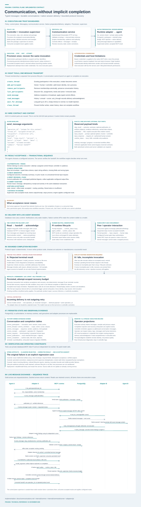

# Communication and completion

[Detailed interaction diagram](images/communications.svg) · [MCP tool implementation](../internal/comms/mcp.go) · [Runtime communication skill](../internal/comms/skill/SKILL.md)



See [native preparation and ownership](runtime-adapters.md) and the [runtime-boundary diagram](images/runtime-adapters.svg) for the launch path. The detailed communication diagram below describes protocol behavior; it does not imply every runner supports native idle/usage observations.

**Known limitation — CTRL-001:** controller-only lifecycle routing is the intended contract. The current Pi bridge still broadcasts lifecycle reports; this defect is not fixed by runtime preparation. Ordinary correspondence and native lifecycle observations must remain distinct.

## Boundaries

| Component | Responsibility |
|---|---|
| Control plane / workflow adapter | Pin assignments, provision invocation identities, supervise processes, consume accepted results, apply configured routes and human authority. |
| Communication service | Authenticate and authorize calls; validate typed content; persist threads, messages, receipts, publications, requests, results and completion-recovery state. |
| MCP | Expose eight tools over authenticated Streamable HTTP. Tool discovery advertises the envelope and reserved payload schemas. No separate completion tool. |
| Native preparer / session bridge | Adapter preparation validates compatibility and generates native launch settings. The native bridge owns scoped MCP injection and native message delivery; lifecycle/telemetry depend on adapter capabilities. Neither chooses workflow routes. |
| Host supervisor | Launch prepared commands, retain output and native identity, and terminate/wait for sessions. It does not interpret Pi configuration. |
| Agent or deterministic package | Perform the assignment, communicate concrete progress/questions/revisions, and submit a valid terminal result. |
| Database | Authoritative durable state. Notifications wake readers; a notification is neither a message nor an acknowledgment. |

The local MCP listener accepts authenticated loopback clients, rejects browser origins, and scopes credentials to one execution/step/visit/attempt participant. This is an authorization boundary for communication, **not a filesystem or process sandbox**. Host agents retain the host user's permissions. Human/controller authority is determined from the authenticated participant, not a claimed sender field.

## Instructions supplied to the worker

The generated assignment contains input-document references, accepted prior results, configured output paths, allowed outcomes, the assigned thread and a complete `send_message` completion example. Multiple allowed outcomes remain a worker choice; the example does not select one. The managed runtime loads `control-plane-comms` as a skill and exposes MCP tool descriptions/schemas. Pi additionally receives its participant ID and native delivery instructions.

These are complementary: the JSON Schema defines structure; the assignment defines allowed outcomes and scope; the skill describes correct use. The server enforces the contract even when the model ignores an instruction. It cannot guarantee that a model chooses a truthful outcome or follows a repair instruction.

## Tool surface

| Tool | Effect |
|---|---|
| `create_thread` | Create a conversation among existing participants in the same execution. Does not launch agents. |
| `add_participant` | Add a known execution participant; requires thread owner or human/controller authority. |
| `remove_participants` | Remove memberships, preserving history. Does not stop the underlying processes. |
| `list_participants` | Discover identities, responsibilities and active/removed state. |
| `send_message` | Send addressed or broadcast A2A content; reserved kinds have typed data contracts. |
| `read_messages` | Read visible history/unread messages; optionally acknowledge a retained cursor. |
| `wait_for_message` | Long-poll visible messages, up to 30 seconds. Does not itself inject a model turn. |
| `close_thread` | Close further writes, preserving history. Does not complete an execution. |

The communication envelope reuses A2A 0.3 content parts. This is not an implementation of the entire A2A task protocol. Custom payload kinds remain available for application conversations; they cannot masquerade as reserved kinds to bypass validation.

## Typed content

All payloads contain `kind`, `version: 1`, and `parts`. Reserved kinds require exactly one data part, with optional text parts. Tool discovery exposes the same data definitions used by server validation. The MCP Go SDK's low-level `AddTool` does not validate arguments automatically: Controls explicitly validates the raw send envelope and typed data before applying effects.

| Kind | Required data | Additional data / effect |
|---|---|---|
| `step_result` | `outcome`, `summary` | Optional `publication_id`, `artifacts`, `evidence`, `data`; completes only this invocation after acceptance. |
| `publication` | `files` (explicit array of names) | Retains exact file bytes and digests; returns a publication ID. |
| `input_request` | `prompt` | Optional string `options`; addresses controller and human; creates a pending request. |
| `input_response` | `request_id`, `answer` | Authorized human response; correlates to the pending request and validates the option. |
| `runtime_status` | `state` (`busy` or `idle`) | Adapter lifecycle observation, addressed to the controller in the assigned thread. Never proves task completion. |

`message` and `progress` carry ordinary A2A content without terminal workflow effects. Agent-facing skills tell the model to leave `runtime_status` to its adapter. An adapter shares its worker credential, so this lifecycle observation is not an independently trusted security signal.

### Completion call

```json
{
  "operation_id": "build-result-001",
  "thread_id": "ASSIGNED_THREAD_ID",
  "recipients": ["CONTROLLER_ID_FROM_LIST_PARTICIPANTS"],
  "payload": {
    "kind": "step_result",
    "version": 1,
    "parts": [{
      "kind": "data",
      "data": {
        "outcome": "AN_OUTCOME_ALLOWED_BY_THIS_ASSIGNMENT",
        "summary": "Implemented the assigned change; recorded actual checks and limitations."
      }
    }]
  }
}
```

Normally omit `artifacts`: the host collects configured outputs from the execution files directory. Additional artifacts are objects, e.g. `[{"name":"extra.md"}]`, **not filename strings**. Supplied URIs/digests do not establish evidence; the host verifies the actual files. `evidence` references have `kind` and `uri`; `data` holds named structured outputs for configured input bindings. If the thread has a current publication, supply its `publication_id`; changed files require a new publication/review. Actor and timestamp are host-assigned; serialized `actor`/`at` fields from existing deterministic clients have no authority. `interruption` is reserved for the host and is rejected from worker messages.

Acceptance validates identity, assigned thread, configured outcome, summary, pending input, current publication and applicable output files. Message, result and idempotency receipt commit together. A receipt includes:

```json
{"state":"stored","effect":{"state":"accepted","result_id":"MESSAGE_ID","routing":"pending"}}
```

Only a **`step_result` receipt** with `effect.state=accepted` completes the invocation. Acceptance of a publication, input or runtime-status message does not. `stored` alone, process exit, final chat, or an idle turn does not. Routing remains the workflow layer's responsibility. Acceptance does not approve the product, complete a peer, or waive a human gate.

## Errors and bounded recovery

| Condition | Behavior |
|---|---|
| Invalid JSON shape, field type or configured outcome | Return an actionable classified error. Correct the payload and use a new operation ID. Validation failures are not temporary service outages. |
| Uncertain transport response | Retry identical content with the original operation ID. A committed success returns its original receipt. |
| `internal_error` | Inspect controller diagnostics; do not assume the operation is transient. |
| Rejected terminal result | Persist a rejection marker. The invocation supervisor asks the communication service to send a controller correction to that worker. It includes the safe reason, allowed outcomes and full completion example. |
| Explicit idle lifecycle, no accepted result | After two minutes, start completion reminders unless a formal human request is pending or another incomplete peer is busy/has unknown lifecycle state. When every incomplete peer is observed idle, recovery can prompt them. Quiet stdout alone never establishes idle. |
| Recovery limit reached | Fence the worker credential, record exhaustion, stop its session and fail the invocation. Existing workflow retry policy may retry or block the step. Never manufacture success. |

Defaults in `RecoveryPolicy`: **two controller reminders**, at least **30 seconds apart**, with a final response interval before exhaustion. For ordinary idle recovery, the worker must remain/re-enter the two-minute idle condition; active work is not terminated simply for being quiet. Rejected-result recovery does not require idle telemetry. A formal pending human request pauses both rejection and ordinary idle recovery until answered. Counters, deadlines, latest rejection and exhaustion reason are persisted in `factory.comms_completion` (migration 000005), scoped to one participant/attempt. New valid progress/status messages do not reset the reminder allowance. Repeated unchanged idle observations do not reset the idle clock. These are service defaults, not new `factory.json` settings.

Reminders are durable, addressed thread messages, emitted at most once per counter under the execution transaction lock. Replays/multiple supervisors cannot duplicate a reminder. Result acceptance uses the same lock: an accepted result wins before further recovery; exhaustion fences late submissions. Rejection/exhaustion activity and reminder messages appear in the execution stream and monitor.

Automatic delivery handles **incoming** messages. It never resubmits a rejected **outgoing** result. The agent must correct and submit it. Recovery prompts explicitly forbid repeating completed implementation or verification just to repair a handoff.

## Pi and other runners

Pi maps native prompt dispatch to `runtime_status: busy` and `agent_settled` to `runtime_status: idle`, using `send_message` under its scoped identity. Lifecycle calls are serialized and retry unchanged operation IDs up to three times; persistent failure terminates the session visibly. Incoming messages are queued/steered through Pi RPC and acknowledged after successful handoff. Acknowledgment proves delivery, not model comprehension or execution.

Another runner implements the same MCP connection, schema, lifecycle observation and delivery contract using its native APIs. It must retain one ordered cursor and avoid competing model/background readers. No Pi event names belong in the communication service or workflow engine. Packages without idle telemetry still receive rejected-result recovery; missing-result idle recovery requires a runtime capable of reporting idle. Existing invocation time/budget and process-exit supervision remain in force. A stopped process cannot be woken by a stored message.

## Verification

`go test ./...` covers raw MCP schema validation, the original string-array artifact failure, corrected/idempotent completion, persisted controller corrections, replay deduplication, bounded recovery across service reopen, peer/human waits, artifact verification and supervisor behavior. `npm test` covers the adapter with fake Pi sessions and a local MCP server, without model calls. These checks do not replace an unattended eval of model behavior. Rebuild/install the binary and restart the local service before a new eval; existing processes do not acquire new embedded schemas/skills from source edits.
