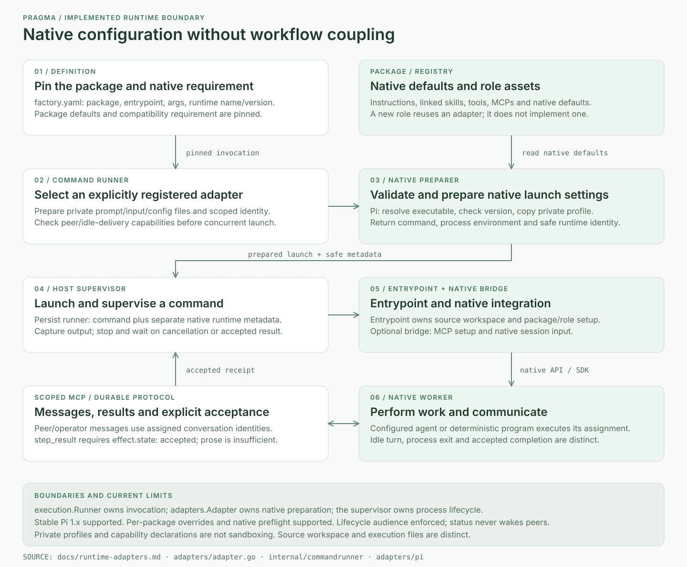

# Adding an agent runtime

Controls separates package execution from native agent integration. Use an existing adapter to add another role; implement an adapter only when introducing a different native runner or a materially different session interface.



## Concepts and dependency direction

| Concept | Example | Responsibility |
|---|---|---|
| Package | Registry architect | Role, native defaults, instructions, skills, tools and entrypoint |
| Native runtime | Pi | The agent program and its version |
| Runtime adapter | `adapters/pi` | Native preparation and translation of session behavior |
| Host execution | `command` | Local supervised process, output, cancellation and persistence |
| Workflow execution | `execution.Runner` | One step invocation, accepted result, attempts and budgets |
| Scheduler | `execution.Engine` | Durable routes, loops and decisions |

The interfaces are in [execution/runtime.go](../execution/runtime.go), [native runtime types](../execution/native.go) and [adapters/adapter.go](../adapters/adapter.go). The application [composition root](../internal/app/server.go) registers `command` and `pi` adapters explicitly. The command runner depends on the adapter interface, not on Pi. A native adapter must not import scheduling or controller packages.

Before this boundary, every package was recorded as `command`; scripts independently prepared native profiles and chose a native bridge. The managed sequence is now:

```text
factory.json → pinned package + native runtime requirement
  → command runner: private invocation files and scoped MCP assignment
  → selected adapter: capability check, native validation/preparation
  → session supervisor: package entrypoint, runtime identity and private environment
  → package entrypoint: script-owned source workspace and role/skill selection
  → native bridge: scoped MCP injection and native session input/output
  → native process
  → accepted MCP result → command runner stops and waits for the session
```

No new package ecosystem or dynamic adapter discovery is involved.

## Register a package

```json
{
  "packages": [
    {
      "name": "builder",
      "path": "../registry/agents/coder_golang",
      "entrypoint": "start.sh",
      "runtime": {
        "name": "pi",
        "version": "=1.0.3",
        "executable": "/opt/tools/pi"
      },
      "args": ["--workspace", "${variables.workspace}", "{prompt}"]
    }
  ]
}
```

This is a fragment; `variables.workspace` must be defined by the factory. Paths to packages resolve from `factory.json`. `runtime.executable` selects an installed native program on the execution host, not a new source workspace; omit it to use the adapter's default executable on the service's `PATH`. A relative executable path containing a path separator resolves from `factory.json`; a bare command name resolves on the execution service’s `PATH`.

`runtime.name` selects a statically registered adapter. `runtime.version` is an optional semantic-version constraint intersected with the adapter's supported range. The requirement participates in the pinned execution definition. An absent `runtime` means an opaque `command` package, not inferred Pi support. Such packages can use MCP themselves, but Controls does not advertise native agent capabilities on their behalf. Concurrent loops require an explicitly capable adapter.

The host `runner` remains `command` in session records; `runtime` records native name, detected version, adapter contract version, resolved executable and capabilities separately. Native metadata is persisted with the session's existing JSON record; no additional database schema is required. A recovered existing session retains its recorded identity rather than being prepared or launched again.

`with` remains package-specific JSON at `FACTORY_PACKAGE_CONFIG`. Pi **does not yet implement provider/model overrides** and rejects nonempty `with` when selected explicitly. CTRL-005 owns that translation. Do not assume selecting a runner implements override fields.

## Preparation interface

Implement `adapters.Adapter`:

- `Name()` identifies the explicitly selected native adapter.
- `Capabilities()` reports implemented behavior without launching a program or contacting a provider.
- `Prepare(ctx, Request)` validates host-dependent prerequisites and returns `Prepared` launch details.

`Request` supplies the pinned package (including native requirement/settings), original package command, execution/step/visit/attempt identity, configuration/project directory, private invocation directory, execution-files directory and explicit prompt/input/config paths. The adapter may generate configuration from the native defaults, use arguments instead, or both. It must not require every runner to have Pi-style JSON profiles.

`Prepared` supplies command arguments, process-only environment additions, input mode and safe native identity. The command runner supplies the launch directory and scoped MCP credentials separately. Adapters cannot replace its reserved invocation environment. They do not start or supervise a long-lived process themselves. A bounded version probe is preparation, not readiness or successful authentication.

Keep metadata typed and non-secret: do not put credentials, entire environments or arbitrary native configuration in `RuntimeIdentity`. Process-only `Environment` is never copied into session records. It is not a secret store.

### Validation and ownership

| Operation | Owner |
|---|---|
| JSON shape, runtime name syntax, version-constraint syntax, package paths, workflow references | Configuration loader and execution validation |
| Adapter existence and concurrent capability requirement | Adapter registry before launch |
| Installed executable/version and adapter-specific settings/profile validation | Adapter preparation on the execution host |
| Invocation directory, prompt, bound inputs, package settings file, scoped identity/token, communication skill | Command runner |
| Managed Pi native-profile copy and exact executable selection | Go Pi preparer |
| Source workspace selection, role-specific tool preflight, linked instructions/skills | Registry entrypoint |
| Managed Pi MCP profile entry, native RPC input, peer delivery, usage/tool translation | Pi JavaScript bridge |
| Process output, termination, session records and cancellation | Session supervisor |
| Accepted result validation and durable receipt | Communication service |
| Invocation files retention | Existing host runtime retention policy; adapters do not delete active invocation files |

The generic command runner launches from the configuration/project directory. An entrypoint may select a different source workspace using its existing script interface. `FilesDir` remains execution-owned documents/artifacts; it is not inferred from the native runner or a process's changed working directory. This boundary does not resolve CTRL-004's separate source-workspace prompting defect.

For Pi, a selected managed profile is reused by the Registry entrypoint. Standalone launches still create their own profile and invoke Pi normally. There is no second managed copy or native configuration merge in each role script. MCP injection remains owned solely by the JavaScript bridge.

## Compatibility and credentials

Use an explicit supported range in the native adapter and intersect it with the package's requested range. The Pi preparer accepts the currently tested `1.0.3` release; extending that range requires compatibility evidence. Pi below 1 and Pi 2 are unsupported. Version detection uses `--version`, accepts a bare semantic version, and times out after five seconds. The probe receives only PATH, home and temporary-directory environment settings, not service provider/engine credentials. Runners with banners or a different version interface need a native parser/probe, not changes to the generic scheduler.

Resolve the executable once and pass the exact absolute path into the launch path. Do not probe one `pi` and subsequently launch another via a different `PATH`. Version requirements are pinned; installed executable bytes are not vendored or frozen. New attempts probe again and record their actual runtime identity. No automatic upgrade occurs. Historical identity remains available to compare attempts.

Native defaults may contain credential environment references. The service environment, not the submitting terminal's environment, reaches the process. This task does not add credential remapping or provider/model overrides. An adapter implementing those later must validate reference names and native precedence, fail before provider calls when credentials are missing, and keep values out of prompts, logs, errors and persisted metadata.

Private directories/files use `0700`/`0600`. The host runner inherits trusted service privileges and rejects access grants it cannot enforce. A private profile, a capability declaration and a changed directory are **not sandboxing**.

## Native session contract

1. Load the assignment from the supplied prompt/inputs and join only the assigned conversation through its scoped MCP connection.
2. Prepare the runner's native MCP configuration or use an SDK bridge. Load the communication skill when the worker is an LLM; deterministic workers can implement the same protocol directly.
3. Discover the controller using `list_participants`; do not hard-code participant IDs. Send ordinary messages to explicit recipients.
4. Deliver peer messages through the native input mechanism. Exactly one consumer owns automatic delivery; do not run a competing model-side wait loop when a background adapter already waits.
5. Submit a `step_result` containing an allowed outcome to that controller through `send_message`. Check `effect.state: accepted`. A file, idle turn, process exit or success-looking prose is not completion.
6. Propagate native/provider failures visibly. Do not disguise aborts, malformed native output or exhausted continuations as normal idle waiting.
7. On cancellation or accepted completion, allow the supervisor to terminate and wait for the process. Do not leave detached worker processes outside supervision.

Native readiness is adapter-specific. A successful host launch proves only that the entrypoint started; it does not prove authentication, a loaded model or readiness to accept work. Do not expose a fabricated generic "ready" state. A native failure after launch becomes an invocation failure through the existing supervision path.

See the full [communication contract](communications.md) and [resource protocol](resources.md). Lifecycle reports must describe observed busy/idle transitions and go only to the controller. **CTRL-001 remains open:** the current Pi bridge still has a lifecycle broadcast defect. Do not copy that behavior into a new adapter or claim enforced controller-only routing until it is fixed.

## Capability matrix

Capabilities are adapter implementation promises, not user-provided grants. Controls currently enforces peer messaging plus idle delivery before launching concurrent members. Other flags describe available interfaces/observations; they do not enable a native feature. Ordinary command input remains a transport, not proof the worker reads it.

| Adapter | Operator input | Peer messages / idle delivery | Native lifecycle | Usage / tool events | Version support |
|---|---|---|---|---|---|
| Opaque `command` | Not advertised | Not advertised; concurrent loop rejected | Unavailable | Not advertised; a package may emit the generic protocol itself | No native version probe |
| Pi | Native RPC steering | Implemented | Observed, with CTRL-001 routing defect | Translated from native events; missing price remains unknown | 1.0.3; incompatible requirements rejected |
| Independent fixture (tests only) | Not implemented | MCP wait loop | Unavailable | Unavailable; no fabricated model counters | 1.0.0 |

Do not claim concurrent support just because two processes can launch. Both must remain available for peer messages and supply independently accepted results. A runner that only supports batch completion needs an appropriate capability declaration and must not be used for an unsupported concurrent stage.

## Runnable non-Pi walkthrough

The reference implementation is [adapters/conformance](../adapters/conformance/adapter.go), with a [Go MCP worker](../adapters/conformance/worker/main.go). It reads a simple JSON config, discovers its controller, can exchange a peer message, submits a result and stays alive until supervised cleanup. It does not use Pi, Node, an LLM, model credentials, Pi files or native Pi events.

From the Controls checkout:

```sh
go test ./adapters/... -count=1
go test ./internal/commandrunner -run '^TestRuntimeConformance$' -v -count=1
npm test
```

The integration test builds the Go worker, starts private PostgreSQL and a scoped loopback MCP service, registers the fixture in a test-only adapter registry and drives the actual command runner/session supervisor. It covers configured fixture settings, recorded native identity, accepted completion, native failure, cancellation, concurrent peer communication, distinct invocation directories/configs and unsupported-capability rejection. It does not start the production service or submit a user workflow. Embedded PostgreSQL binaries must be available locally or downloadable on the first test run. No paid provider requests occur.

The fixture registration is `adapters.Registry{"command": adapters.Command{}, "fixture": conformance.Adapter{}}`. Its package selects `runtime: {"name":"fixture","version":"=1.0.0"}` and `with: {"mode":"complete","message":"configured fixture"}`. `peer`, `wait` and `fail` modes exercise their named lifecycle cases. Production does not register `fixture`; these examples run through the conformance test, not an undocumented production CLI option.

## Contributor checklist

- Identify whether this is a new role or a new runner. Reuse an adapter for a new role.
- Implement the small preparation port and explicitly register it in the application composition root.
- Document native defaults, executable/version requirements, configuration mapping and precedence. Reject unsupported options rather than silently ignoring them.
- Establish one owner for preparation, native MCP injection and incoming delivery. Keep standalone package behavior intact.
- Test the real managed launch path with a fake native process, not just a configuration function.
- Verify accepted results, invalid-result errors, native failure, cancellation and cleanup. Verify operator/peer delivery if advertised.
- Test independent concurrent invocations and ensure profiles, credentials, messages and outputs cannot cross invocation identities.
- Verify safe persisted metadata and missing/unsupported capabilities. Never infer unavailable usage, idle state or readiness.
- Add compatibility fixtures and a bounded real-runner startup smoke check before extending a supported range. A fake process verifies translation, not real native compatibility or product quality.
- Update this matrix, the native adapter README, package documentation and factory examples. Use an eval separately to assess agent behavior; conformance tests do not measure coding quality.

## Troubleshooting

| Diagnostic | Action |
|---|---|
| `unsupported runtime "NAME"` | Register that adapter in the host application or select one it supports. |
| `runtime "NAME" does not support concurrent peer delivery` | Choose a capable runner or a sequential workflow. |
| `runtime executable "PATH" unavailable` | Install/select the native executable on the execution host. |
| `runtime version … does not satisfy …` | Use a supported installed version and compatible package requirement. |
| `invalid pi profile …` | Correct the bundle's native JSON; Controls does not guess missing configuration. |
| `pi runtime does not yet support with overrides (CTRL-005)` | Use native bundled defaults until override support is implemented. |
| Native preflight authentication/MCP error | Inspect the resolved private profile and service environment references without printing credentials. |
| Session ended without an accepted result | Inspect native output and result receipts; process exit is not accepted completion. |

Unknown result receipts, failed native calls and missing telemetry are operational evidence, not successful completion. Preserve their meaning in another runner's translation.
